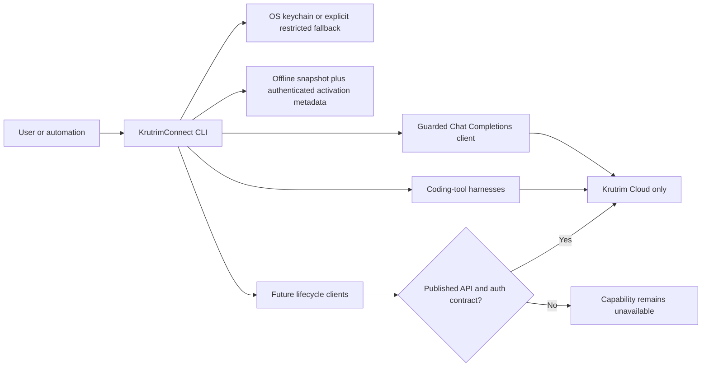

# KrutrimConnect: Krutrim-only CLI platform plan

Status: implementation plan with the first platform slice implemented

Last reviewed: 2026-08-27

## Product decision

KrutrimConnect will expose only Krutrim Cloud as a service provider. The
current production catalogue includes models published by OpenAI, Google, and
Qwen, but all requests still go only to Krutrim Cloud endpoints.

Fireworks is a product-behaviour reference, not a code dependency. Krutrim
Connect does not copy Fireworks service code, private APIs, branding, UI, or
assets. Features are implemented independently against documented Krutrim
contracts and retain KrutrimConnect's existing fail-closed security model.

## Product outcome

The intended command-line experience covers the complete model workflow:

1. install and upgrade safely;
2. authenticate safely;
3. discover and inspect models;
4. try a model with a guarded inference request;
5. connect supported coding tools;
6. fine-tune and evaluate models;
7. manage shared or dedicated deployments; and
8. inspect usage, cost, limits, and operational health.

Each workflow is enabled only when Krutrim publishes or approves the required
API and authentication contract. A console feature alone is not sufficient to
claim CLI support.

## Architecture



The fixed inference origin remains
`https://cloud.olakrutrim.com`. Redirects are not followed, credentials are
never accepted as command-line arguments. Direct chat and job commands require
explicit cost acknowledgement; provider `on` commands report and perform
billable compatibility qualification internally when cached evidence is
unavailable.

## Feature matrix

| User workflow | KrutrimConnect state | Krutrim evidence or dependency |
| --- | --- | --- |
| Public install and upgrade | Installer implemented; release not published | Requires npm name ownership, clean tag, cross-platform package tests, provenance, and a live immutable artifact |
| Secure model-key login | Implemented | Invalid-token control plus authenticated, non-inference `GET /v1/models` validation before storage |
| API-key logout and explicit CI input | Implemented | Explicit environment/stdin input, auth status, guarded local deletion, and stale-copy cleanup |
| Named credential profiles | Planned | Requires per-profile storage and capability/config binding |
| Browser/device login | Blocked | Requires approved Krutrim IAM OAuth/OIDC, refresh, revocation, scope, and tenant contracts |
| Status and non-destructive diagnostics | Implemented | Local config, credential, endpoint, and capability checks |
| Model discovery | Offline commands plus live activation metadata | Bundled console snapshot; authenticated `GET /v1/models` observed and validated for exact-model Codex setup |
| Model inspection and filtering | Implemented | Bundled catalogue metadata only |
| One-shot text chat | Implemented | `POST /v1/chat/completions` and token streaming are documented |
| Codex connection | Capability-gated | Exact model must pass native Responses conformance plus a full installed-Codex native canary, or streaming Chat checks plus a full installed-Codex bridge canary |
| OpenCode connection | Capability-gated internal alpha | Exact model must have fresh streaming bridge evidence; v1/v2 provider schema is preserved, config is restored exactly, and plain `opencode` reads only a private instance-bound local token file |
| Multi-turn CLI playground | Planned | Builds on Chat Completions; needs conversation-state UX and usage limits |
| Live model catalogue and pricing | Partial | Activation consumes authenticated model metadata; a supported pricing/availability contract and user-facing refresh remain open |
| Fine-tuning job create/list/status/cancel | Blocked for production | Public references exist, but identity, base URL, request schema, and safe lifecycle semantics need approval |
| Evaluation jobs | Blocked | Requires public API and result schema |
| Shared/dedicated deployments | Blocked | Console capability is documented; production management API contract is not established |
| Usage, cost, quota, and rate limits | Blocked | Requires tenant-scoped usage and billing APIs |
| Organisation, team, and audit administration | Blocked | Requires IAM contract and explicit scope separate from model keys |
| Azure provider or routing | Out of scope | Krutrim-only provider decision |

## Implemented CLI slice

### Catalogue

```bash
krutrimconnect models list
krutrimconnect models list --modality multimodal
krutrimconnect models list --publisher Qwen --json
krutrimconnect models show Qwen3.6-35B-A3B
```

The command is deliberately offline and labels its data as a bundled, non-live
snapshot observed from the authenticated production console on 2026-08-12. It
contains exactly the eight entries visible there:

- `gpt-oss-20b`
- `gpt-oss-120b`
- `gemma-4-E4B-it`
- `gemma-4-31b-it`
- `gemma-4-26B-A4B-it`
- `Qwen3.5-9B`
- `Qwen3.6-27B`
- `Qwen3.6-35B-A3B`

It never implies that a listed model is enabled for the user's model key. The
Krutrim production console remains authoritative for current availability,
pricing, rate limits, and the exact model identifier.

### Guarded chat

```bash
krutrimconnect login

printf 'Explain this function in two sentences.\n' | \
  krutrimconnect chat \
    --model Qwen3.6-35B-A3B \
    --accept-inference-charges
```

Interactive terminals use a prompt; automation reads UTF-8 from standard
input. Prompts are not accepted as CLI flags, keeping them out of normal shell
history and process listings. Streaming is the default. `--no-stream` requests
a JSON completion, while `--json` produces a machine-readable result and also
disables streaming. Optional `--max-tokens` and `--temperature` values are
validated before any network request.

The client enforces bounded prompt/response sizes, a timeout, the fixed HTTPS
origin, manual redirects, expected content types, and bounded SSE events. Error
response bodies are not printed because they may echo credentials or prompts.

## Delivery phases

### Phase A: secure connection foundation — complete

- keychain-first credential storage;
- explicit restricted-file fallback;
- safe Codex configuration transactions and exact rollback;
- capability evidence, drift detection, and diagnostics.

### Phase B: model discovery and playground — in progress

- bundled catalogue list/show/filter commands — complete;
- one-shot streaming and JSON chat — complete;
- CLI-level command tests and a controlled live smoke test — next;
- multi-turn session with explicit history persistence policy — next;
- exact-model live metadata for Codex catalogs — complete against the observed authenticated endpoint;
- user-facing live catalogue and pricing refresh — blocked on a supported contract.

### Phase C: additional coding-tool connectivity

- retain the native Codex conformance gate;
- retain the OpenCode Chat Completions bridge gate and its strict-JSON
  configuration safeguard;
- plain OpenCode launch with a private instance-bound token file, legacy-session
  migration, exact restore, and token cleanup — complete locally against
  OpenCode 1.18.5;
- add another coding-tool harness only after its exact wire and auth contract is
  documented;
- never infer tool compatibility from generic OpenAI compatibility.

### Phase D: model lifecycle

- fine-tuning dataset validation and dry-run planning;
- job creation only with explicit cost acknowledgement;
- status/list/cancel with idempotency and terminal-state handling;
- evaluation result retrieval;
- shared/dedicated deployment planning, creation, reconciliation, and cleanup.

Phase D begins only after Krutrim owners approve the public endpoint, tenant
identity, authorization, idempotency, billing, and cancellation contracts.

### Phase E: public distribution and authentication UX

- publish a tested, provenance-backed npm artifact from a clean immutable tag;
- promote the versioned macOS/Linux installer only after npm publication;
- add a separately tested Windows PowerShell installer;
- explicit API-key input modes, local logout, stale-copy cleanup, and
  authentication status — complete;
- add named profiles before multi-tenant selection; and
- keep browser/device and workload login blocked until Krutrim IAM publishes
  the required contract.

See the
[distribution and authentication roadmap](distribution-and-auth-roadmap.md)
for the installer contract, release gates, and preferred login progression.

### Phase F: production operations

- usage and cost reporting;
- quotas and rate-limit visibility;
- audit events and organisation controls;
- compatibility policy, operational reliability, and support SLA.

## Release gates

A feature is described as supported only after all applicable gates pass:

1. official or owner-approved API contract;
2. exact authentication and tenant-scope contract;
3. unit tests for validation, redaction, bounds, redirects, and malformed data;
4. opt-in integration test with no credential or prompt logging;
5. ambiguity reconciliation for every mutating or billable lifecycle action;
6. documented pricing, cancellation, retry, and rate-limit behaviour; and
7. rollback or safe cleanup procedure.

## Required Krutrim API decisions

To reach lifecycle parity, the Krutrim API owners need to provide:

- owner approval and stability guarantees for the observed authenticated model
  catalogue, including capabilities, pricing, and availability semantics;
- a supported Responses/tool-call contract for native coding-agent integration;
  the implemented local bridge can operate without inference-team changes when
  Chat function-call, streamed-argument, continuation, and full installed-Codex
  canary checks pass, but remains an explicitly labelled compatibility mode;
- fine-tuning, evaluation, and deployment APIs with bearer authentication and
  tenant scoping suitable for an end-user CLI;
- idempotency keys and explicit asynchronous job state machines;
- usage, quota, billing, cancellation, and retention semantics;
- OAuth/OIDC and service-identity contracts for browser, device, refresh,
  revocation, organisation/project selection, and CI workloads; and
- sandbox/test resources that do not create uncontrolled cost.

## Sources

- [Krutrim production Model Catalogue](https://cloud.olakrutrim.com/console/inference-service?section=catalogue) (authentication required)
- [Krutrim inferencing](https://docs.cloud.olakrutrim.com/basics/ai-studio/ai-jobs/inferencing)
- [Krutrim model API keys](https://docs.cloud.olakrutrim.com/basics/key-management-system/model-api-keys)
- [Krutrim AI Jobs](https://docs.cloud.olakrutrim.com/basics/ai-studio/ai-jobs)
- [Krutrim fine-tuning API reference](https://docs.cloud.olakrutrim.com/api-references/finetuning-api)
- [Fireworks inference concepts](https://docs.fireworks.ai/guides/inference-introduction)
- [Fireworks Responses API behaviour reference](https://docs.fireworks.ai/guides/response-api)
